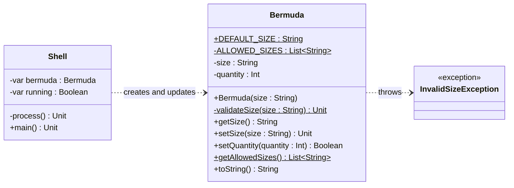

# [GUIDE] Bermuda: exceções para invariantes de tamanho

<!-- toc-table -->
[Intro](#intro) | [Regras](#regras) | [Diagrama](#diagrama) | [Guide](#guide) | [Shell](#shell) | [Draft](#draft)
-- | -- | -- | -- | -- | --
<!-- end -->


## Intro

Esta atividade modela uma bermuda que precisa manter um tamanho válido e uma
quantidade não negativa. Um tamanho inválido lança `InvalidSizeException`; uma
quantidade negativa é recusada com `false`.

O objetivo é distinguir essas duas falhas e manter o estado anterior em ambas.
A quantidade planejada para compra acrescenta uma entrada inteira: o `Shell`
converte o texto, captura falhas de conversão e apresenta os resultados do domínio.

## Regras

- `Bermuda` possui propriedades privadas `size: String` e `quantity: Int`. A quantidade começa em `0` e representa quantas bermudas do tamanho atual serão compradas.
- Os tamanhos permitidos são `P`, `M`, `G` e `GG`.
- `Bermuda(size: String)` e `setSize(size: String): Unit` validam o tamanho e lançam `InvalidSizeException` quando ele não é permitido.
- Uma falha em `setSize` preserva o tamanho anterior.
- `setQuantity(quantity: Int): Boolean` define uma quantidade não negativa e retorna `true`; para valores negativos, retorna `false` sem alterar a quantidade anterior.
- `getSize(): String` consulta o tamanho atual sem alterar o objeto.
- `getAllowedSizes(): List<String>` devolve uma cópia dos tamanhos permitidos.
- O comando `init` tenta criar uma nova bermuda. Se o tamanho for inválido, a bermuda anterior permanece ativa.
- O comando `size` altera a bermuda atual.
- O comando `setQuantity` converte o argumento para `Int` e tenta definir a quantidade.
- `show` apresenta o tamanho e a quantidade em linhas separadas: `size: (P)` e `quantity: (0)` no estado inicial.
- O domínio não lê entrada nem imprime mensagens. O Shell apresenta `fail: invalid size` para um tamanho inválido, `fail: invalid quantity` para quantidade negativa e `fail: invalid conversion` quando o texto de `setQuantity` não é um inteiro.

## Diagrama



## Guide

Implemente em etapas:

1. Crie `Bermuda` com `DEFAULT_SIZE`, a propriedade privada `size: String` e uma lista privada de tamanhos permitidos.
2. Declare `InvalidSizeException : Exception()` sem atributos próprios. Em `validateSize(size: String): Unit`, lance essa exceção quando o tamanho não estiver em `ALLOWED_SIZES`.
3. Faça o construtor validar antes de estabelecer o tamanho inicial e `setSize` validar antes de atribuir. Em ambos os casos, a exceção deve preservar qualquer estado válido já existente.
4. Faça `getAllowedSizes(): List<String>` retornar uma cópia, sem expor a lista interna.
5. Inicialize `quantity` com `0`. Em `setQuantity(quantity: Int): Boolean`, recuse valores negativos antes de alterar a propriedade; devolva `true` depois de aceitar a nova quantidade. Inclua a quantidade em `toString()`.
6. Crie um `Shell` com a bermuda inicial e `running = true`. Faça `process()` ler e executar um comando por vez; `end` encerra o laço de `main()`.
7. No Shell, converta o argumento de `setQuantity` com `toInt()` e apresente `fail: invalid quantity` quando o método retornar `false`. No laço, capture `InvalidSizeException`, `NumberFormatException` e `IndexOutOfBoundsException` para as respectivas entradas inválidas. Só substitua a instância atual quando a construção terminar com sucesso.

`validateSize` existe porque o construtor e `setSize` precisam garantir a mesma invariante: o tamanho atual deve estar na coleção de tamanhos permitidos. Ao concentrar a regra em um método, os dois pontos não duplicam a condição. Cada operação só altera o estado depois que a validação termina com sucesso. Não é necessário chamar `setSize` no construtor: a validação não depende de um estado já criado, e o construtor pode estabelecer o primeiro estado válido diretamente.

`InvalidSizeException` identifica a falha de validação do construtor e de
`setSize`. A recusa de uma quantidade negativa é comunicada por `false`.

Perguntas de reflexão:

- Qual é a diferença entre retornar `false` e lançar `InvalidSizeException`?
- Por que a validação precisa ocorrer antes da atribuição?
- Por que o `Shell` deve capturar a exceção em vez de `Bermuda` imprimir a falha?
- O que aconteceria se `init` substituísse a bermuda antes de validar o novo tamanho?
- Por que `setQuantity` retorna `false` para uma quantidade negativa, enquanto `setSize` lança uma exceção para um tamanho inválido?
- Por que a conversão de `setQuantity` pertence ao Shell, mas a regra de quantidade não negativa pertence a `Bermuda`?

O `Shell` apresenta `fail: invalid size` para tamanhos recusados,
`fail: invalid quantity` para quantidade negativa,
`fail: invalid conversion` para texto que não pode ser convertido em `Int`,
`fail: insufficient parameters` para comando sem argumento e
`fail: invalid command` para comandos desconhecidos. As mensagens ficam na
interface.

## Shell

```bash
#TEST_CASE quantity and conversion preserve state
$setQuantity 3
$show
size: (P)
quantity: (3)
$setQuantity three
fail: invalid conversion
$show
size: (P)
quantity: (3)
$setQuantity -1
fail: invalid quantity
$show
size: (P)
quantity: (3)
$end
```

```bash
#TEST_CASE missing quantity and reinitialization
$setQuantity 2
$setQuantity
fail: insufficient parameters
$show
size: (P)
quantity: (2)
$init M
$show
size: (M)
quantity: (0)
$end
```

```bash
#TEST_CASE init without size preserves previous object
$init G
$init
fail: insufficient parameters
$show
size: (G)
quantity: (0)
$end
```

```bash
#TEST_CASE size without argument preserves state
$init M
$size
fail: insufficient parameters
$show
size: (M)
quantity: (0)
$end
```

```bash
#TEST_CASE initial state
$show
size: (P)
quantity: (0)

#TEST_CASE valid size
$size M
$show
size: (M)
quantity: (0)

#TEST_CASE invalid setter preserves state
$size XG
fail: invalid size
$show
size: (M)
quantity: (0)
$end
```

```bash
#TEST_CASE invalid constructor preserves previous object
$init GG
$show
size: (GG)
quantity: (0)
$init XG
fail: invalid size
$show
size: (GG)
quantity: (0)
$end
```

```bash
#TEST_CASE all allowed sizes
$init P
$size M
$size G
$size GG
$show
size: (GG)
quantity: (0)
$end
```

```bash
#TEST_CASE invalid command
$resize G
fail: invalid command
$end
```

## Draft

<!-- links .cache/starter -->
<!-- end -->
