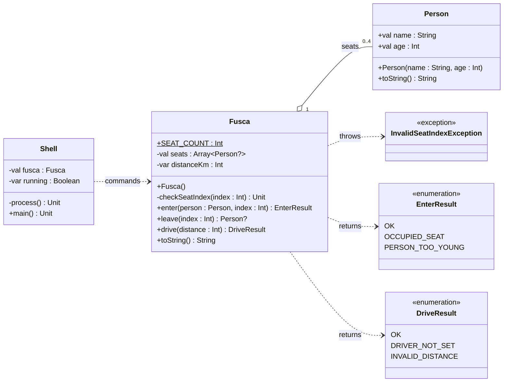

# [TRAIN] Fusca: posições, exceções e direção

<!-- toc-table -->
[Intro](#intro) | [Regras](#regras) | [Resultados e exceções](#resultados-e-exceções) | [Diagrama](#diagrama) | [Guide](#guide) | [Shell](#shell) | [Draft](#draft)
-- | -- | -- | -- | -- | -- | --
<!-- end -->


## Intro

Esta atividade é uma evolução de `Carro`. Agora cada pessoa é um objeto e
ocupa uma posição específica no Fusca.

O objetivo principal é combinar posições fixas com resultados de operação e
uma exceção para acesso a assentos inexistentes. A atividade também
pratica agregação: `Fusca` recebe objetos `Person` criados pelo `Shell` e pode
devolvê-los por `leave()`.

## Regras

- `Person` é uma `data class` Kotlin com `name: String` e `age: Int`.
- O Fusca possui quatro assentos fixos:
  - índice `0`: motorista;
  - índice `1`: passageiro da frente;
  - índices `2` e `3`: passageiros de trás.
- Um assento ocupado não pode receber outra pessoa.
- O motorista deve ter pelo menos 18 anos.
- O passageiro da frente deve ter pelo menos 10 anos.
- Os passageiros de trás não possuem restrição adicional de idade.
- Índices de assento fora de `0..3` lançam `InvalidSeatIndexException`.
- `leave(index: Int): Person?` retorna a pessoa removida ou `null` quando o assento válido
  está vazio.
- `enter(person: Person, index: Int): EnterResult` retorna `OK`, `OCCUPIED_SEAT` ou `PERSON_TOO_YOUNG`; exige assento vazio e idade mínima de 18 para motorista ou 10 para passageiro da frente.
- `drive(distance: Int): DriveResult` retorna `OK`, `DRIVER_NOT_SET` ou `INVALID_DISTANCE`; só aumenta a quilometragem quando existe motorista e a distância é positiva.
- Não há gasolina nesta versão: a remoção dessa regra permite concentrar a
  atividade nas posições e no tratamento de falhas.
- O domínio não lê entrada nem imprime mensagens. O `Shell` traduz os resultados
  e as exceções em mensagens observáveis.

## Resultados e exceções

Assento ocupado, pessoa jovem demais, motorista ausente e distância não positiva
são recusas previstas das operações. `enter` e `drive` as comunicam por
`EnterResult` e `DriveResult`, sem alterar o estado. `leave` devolve a pessoa
removida ou `null` quando o assento válido está vazio.

`InvalidSeatIndexException` indica que o índice não representa um assento.
Essa exceção distingue assento inexistente de argumento ausente no comando.
O `Shell` captura `IndexOutOfBoundsException` somente quando falta um argumento
em `args`; `NumberFormatException` indica conversão numérica inválida.

O `Shell` traduz os resultados e as exceções em mensagens; `Fusca` não contém
textos de saída.

## Diagrama



## Guide

Implemente em etapas:

1. Crie `Person` como uma `data class` com propriedades `val name: String` e `val age: Int`; sobrescreva `toString()` para produzir `name:age`.
2. Crie quatro posições `Array<Person?>`, inicialmente `null`, e o acumulador `distanceKm`.
3. Implemente `checkSeatIndex(index: Int)` e lance `InvalidSeatIndexException` para índices inválidos.
4. Implemente `enter(person: Person, index: Int)`. Valide o índice; para assento ocupado ou idade insuficiente, retorne o valor de `EnterResult` correspondente antes de alterar o vetor. Retorne `OK` após inserir a pessoa.
5. Implemente `leave(index: Int)`, retornando a pessoa removida ou `null` quando o assento válido estiver vazio.
6. Implemente `drive(distance: Int)`, retornando `DRIVER_NOT_SET` quando não houver motorista e `INVALID_DISTANCE` quando a distância não for positiva. Após atualizar a quilometragem, retorne `OK`.
7. No `Shell`, use `split(" ")` e acesse os argumentos do comando diretamente. Crie `Person` a partir deles, traduza os resultados com `when` e capture as exceções em `main()`, com as mensagens diretamente nos `println`. `NumberFormatException` indica conversão inválida; `IndexOutOfBoundsException` indica parâmetro ausente. O domínio não deve conhecer as mensagens de saída.

Não é necessário criar uma classe `Seat`: o índice é uma informação do domínio
e as regras dos quatro assentos são pequenas. Também não é necessário manter
uma contagem separada de passageiros, pois ela pode ser obtida da lista de
assentos quando for necessária.

Perguntas de reflexão:

- Por que `leave` pode usar `null`, enquanto `enter` precisa de um enum para distinguir as recusas?
- Por que uma exceção própria distingue índice de assento inválido de argumento ausente no `Shell`?
- Por que distância não positiva é um resultado de `drive`, enquanto índice de assento inexistente é uma exceção?
- O que seria perdido se `Fusca` recebesse apenas nome e idade em vez de um
  objeto `Person`?
- Por que a regra de idade pertence a `Fusca`, e não a `Person`?

## Shell

```bash
#TEST_CASE initial state and enter
$show
seats: [0:(empty), 1:(empty), 2:(empty), 3:(empty)], km: 0
$enter joao 18 0
$enter ana 10 1
$enter bia 8 2
$enter caio 30 3
$show
seats: [0:joao:18, 1:ana:10, 2:bia:8, 3:caio:30], km: 0
$end
```

```bash
#TEST_CASE occupied and invalid seats
$enter joao 25 0
$enter joao 25 0
fail: occupied seat
$enter dora 20 4
fail: invalid seat
$enter dora 20 -1
fail: invalid seat
$leave 4
fail: invalid seat
$show
seats: [0:joao:25, 1:(empty), 2:(empty), 3:(empty)], km: 0
$end
```

```bash
#TEST_CASE invalid input keeps shell running
$enter ana idade 0
fail: invalid conversion
$enter ana 18
fail: insufficient parameters
$leave
fail: insufficient parameters
$show
seats: [0:(empty), 1:(empty), 2:(empty), 3:(empty)], km: 0
$enter ana 18 0
$show
seats: [0:ana:18, 1:(empty), 2:(empty), 3:(empty)], km: 0
$end
```

```bash
#TEST_CASE age restrictions
$enter driver 17 0
fail: person is too young for this seat
$enter front 9 1
fail: person is too young for this seat
$enter driver 18 0
$enter front 10 1
$show
seats: [0:driver:18, 1:front:10, 2:(empty), 3:(empty)], km: 0
$end
```

```bash
#TEST_CASE leave returns person or none
$enter joao 25 0
$enter bia 8 2
$leave 2
bia:8
$leave 2
$leave 3
$show
seats: [0:joao:25, 1:(empty), 2:(empty), 3:(empty)], km: 0
$end
```

```bash
#TEST_CASE drive
$drive 10
fail: driver is not set
$enter joao 25 0
$drive 0
fail: distance must be positive
$drive -5
fail: distance must be positive
$drive 15
$drive 5
$show
seats: [0:joao:25, 1:(empty), 2:(empty), 3:(empty)], km: 20
$end
```

## Draft

<!-- links .cache/starter -->
<!-- end -->
