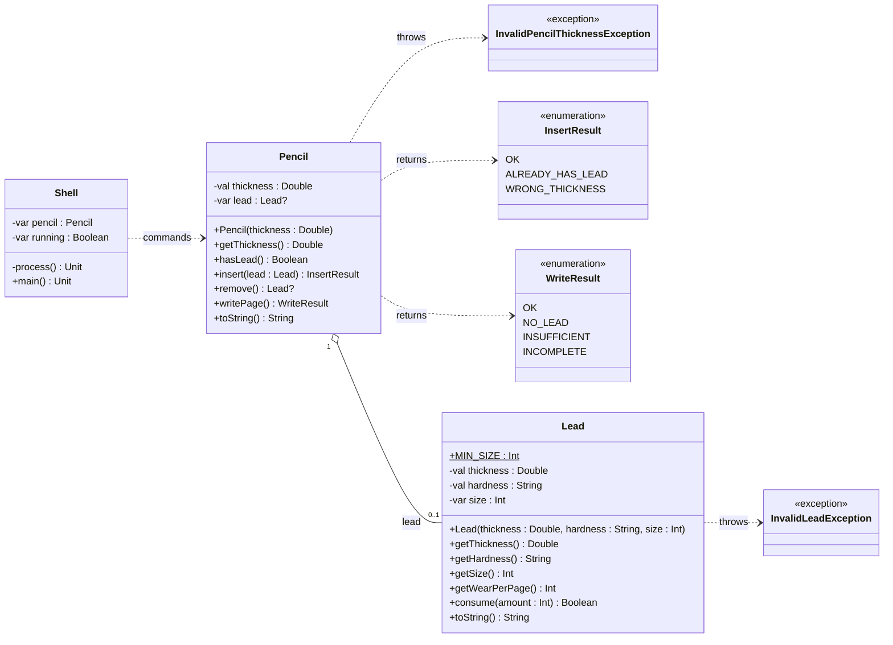

# [TRAIN] Grafite com exceções

<!-- toc-table -->
[Intro](#intro) | [Regras](#regras) | [Diagrama](#diagrama) | [Guide](#guide) | [Shell](#shell)
-- | -- | -- | -- | --
<!-- end -->


## Intro

Esta atividade retoma [Grafite](../grafite/README.md). A lapiseira continua com um único grafite opcional no bico; não há tambor nem coleção de reservas. A novidade é validar os dados antes de criar `Pencil` ou `Lead`, usando exceções para impedir objetos inválidos.

Em Bermuda, um tamanho inválido lança uma exceção enquanto uma quantidade negativa retorna `false`. Aqui a mesma distinção aparece no fluxo do grafite: dados inválidos para construção lançam exceções; bico ocupado, calibre incompatível, remoção sem grafite e escrita impossível continuam sendo resultados das operações. O `Shell` transforma cada caso em mensagem e continua recebendo comandos.

## Regras

- `Pencil(thickness: Double)` exige calibre finito e positivo. Caso contrário, lança `InvalidPencilThicknessException`.
- `Lead(thickness: Double, hardness: String, size: Int)` exige calibre finito e positivo, dureza `HB`, `2B`, `4B` ou `6B` e tamanho de pelo menos `10mm`. Caso contrário, lança `InvalidLeadException`.
- `Pencil` guarda no máximo um `Lead?`. Os objetos `Lead` são criados fora dela e podem ser devolvidos por `remove()`, caracterizando agregação.
- `insert(lead: Lead): InsertResult` retorna `ALREADY_HAS_LEAD` ou `WRONG_THICKNESS` sem alterar o bico; retorna `OK` após inserir.
- `remove(): Lead?` devolve o grafite removido ou `null` se o bico já estava vazio.
- `Lead.getWearPerPage()` devolve `1`, `2`, `4` ou `6` milímetros para `HB`, `2B`, `4B` ou `6B`, respectivamente.
- `Lead.consume(amount: Int): Boolean` exige quantidade não negativa. Consome até o limite de `10mm` e retorna `false` se não conseguir consumir a quantidade inteira.
- `writePage(): WriteResult` retorna `NO_LEAD` sem grafite, `INSUFFICIENT` quando ele já mede `10mm`, `INCOMPLETE` quando chega a `10mm` antes de terminar a folha e `OK` após uma folha completa.
- `init` só substitui a lapiseira atual depois de construir uma nova instância válida. Construção, conversão ou acesso a argumento com falha não alteram o estado existente.
- O domínio não lê comandos nem imprime mensagens. O `Shell` usa `split(" ")`, acessa os argumentos e captura as exceções em `main()`.

As mensagens de `insert`, `remove` e `write` permanecem iguais às de Grafite. Os novos casos exibem `fail: invalid thickness`, `fail: invalid lead`, `fail: invalid conversion` ou `fail: insufficient parameters`.

## Diagrama



## Guide

1. Comece com o modelo de Grafite: um `Lead?` no bico de `Pencil`, sem tambor. Execute os casos existentes de inserção, remoção e escrita.
2. Faça os construtores validarem antes de estabelecer o estado. Lance `InvalidPencilThicknessException` para calibre inválido da lapiseira e `InvalidLeadException` para dados inválidos do grafite. Mantenha a regra de tamanho mínimo em `Lead`.
3. Preserve `InsertResult`, `WriteResult` e o retorno nullable de `remove()`: essas operações representam recusas previstas ou devolvem o objeto retirado.
4. Crie um `Shell` com `process()` para executar um comando e `main()` para capturar as exceções. Faça `init` atribuir a nova `Pencil` somente depois de sua construção bem-sucedida.
5. Teste calibre, dureza e tamanho inválidos; conversão inválida; parâmetro ausente; e o estado após cada falha. Confirme que os casos de Grafite continuam com a mesma saída.

A mudança posterior para um tambor pode ser feita em outra atividade. Ela deve acrescentar uma coleção ordenada sem precisar redescobrir as regras de validade e desgaste de `Lead`.

Perguntas de reflexão:

- Por que um `Lead` com dados inválidos impede a construção, enquanto `insert` devolve um resultado para bico ocupado?
- Por que `init` deve construir a nova lapiseira antes de substituir a atual?
- Quais testes demonstram que uma exceção não alterou o estado?

## Shell

```bash

#TEST_CASE inserting leads

$init 0.5
$show
thickness: 0.5, lead: null

#TEST_CASE wrong thickness

$insert 0.7 2B 50
fail: wrong thickness
$insert 0.5 2B 50
$show
thickness: 0.5, lead: [0.5:2B:50]
$end
```

***

```bash

#TEST_CASE inserting

$init 0.3
$insert 0.3 2B 50
$show
thickness: 0.3, lead: [0.3:2B:50]

#TEST_CASE already has lead

$insert 0.3 4B 70
fail: already has lead
$show
thickness: 0.3, lead: [0.3:2B:50]

#TEST_CASE removing

$remove
$show
thickness: 0.3, lead: null

#TEST_CASE inserting after removal

$insert 0.3 4B 70
$show
thickness: 0.3, lead: [0.3:4B:70]
$end
```

***

```bash

#TEST_CASE no lead

$init 0.9
$write
fail: no lead

#TEST_CASE insufficient size

$insert 0.9 4B 14
$write
$write
fail: insufficient size
$show
thickness: 0.9, lead: [0.9:4B:10]
$end
```

***

```bash

#TEST_CASE writing page

$init 0.9
$insert 0.9 4B 16
$write
$show
thickness: 0.9, lead: [0.9:4B:12]

#TEST_CASE incomplete page

$write
fail: incomplete page
$show
thickness: 0.9, lead: [0.9:4B:10]
$end
```

```bash
#TEST_CASE hardness wear
$init 0.5
$insert 0.5 HB 15
$write
$show
thickness: 0.5, lead: [0.5:HB:14]
$remove
$insert 0.5 6B 15
$write
fail: incomplete page
$show
thickness: 0.5, lead: [0.5:6B:10]
$end
```

```bash
#TEST_CASE invalid construction preserves state
$init 0.5
$insert 0.5 HB 20
$init -0.5
fail: invalid thickness
$init 0
fail: invalid thickness
$insert 0.5 XX 20
fail: invalid lead
$insert 0.5 HB 9
fail: invalid lead
$insert NaN HB 20
fail: invalid lead
$insert -0.5 HB 20
fail: invalid lead
$show
thickness: 0.5, lead: [0.5:HB:20]
$end
```

```bash
#TEST_CASE minimum lead size is valid but cannot write
$init 0.5
$insert 0.5 HB 10
$write
fail: insufficient size
$show
thickness: 0.5, lead: [0.5:HB:10]
$end
```

```bash
#TEST_CASE malformed input keeps shell running
$init 0.5
$insert 0.5 HB nope
fail: invalid conversion
$insert 0.5 HB
fail: insufficient parameters
$init
fail: insufficient parameters
$show
thickness: 0.5, lead: null
$end
```
