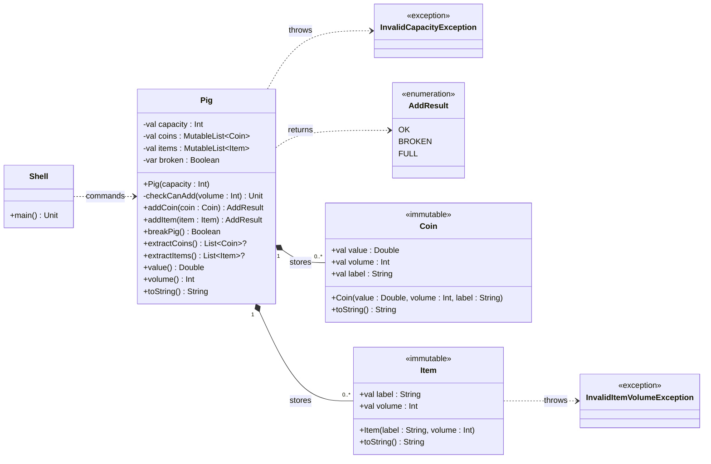

# [TRAIN] Guardando moedas e itens em um cofrinho

<!-- toc-table -->
[Intro](#intro) | [Regras](#regras) | [Exceções](#exceções) | [Diagrama](#diagrama) | [Guide](#guide) | [Shell](#shell) | [Draft](#draft)
-- | -- | -- | -- | -- | -- | --
<!-- end -->


## Intro

Esta atividade modela um porquinho com capacidade limitada que deixa de ser
utilizável quando é quebrado. O objetivo principal é proteger invariantes de
capacidade e de estado. Como objetivo secundário, a atividade pratica a
composição de objetos e a imutabilidade de valores armazenados.

## Regras

- `Coin` é uma classe com propriedades `val value: Double`, `val volume: Int` e `val label: String`. Valor não finito ou não positivo e volume não positivo são rejeitados pelo construtor com `IllegalArgumentException`. Os códigos disponíveis no Shell são `10`, `25`, `50` e `100`.
- `Item` é uma classe com propriedades `val label: String` e `val volume: Int`. Volume não positivo lança `InvalidItemVolumeException`.
- Moedas e itens são imutáveis depois de criados. Não há setters, pois alterar
  um objeto já guardado poderia quebrar a capacidade do porquinho. Ao inserir,
  `Pig` cria um novo objeto com os mesmos valores, de modo que o objeto armazenado pertence ao recipiente.
- `Pig(capacity: Int)` começa intacto e vazio. Capacidade negativa lança `InvalidCapacityException`; capacidade zero é válida. Seu volume ocupado nunca ultrapassa a capacidade.
- `addCoin(coin: Coin): AddResult` e `addItem(item: Item): AddResult` retornam `OK`, `BROKEN` ou `FULL`. Apenas `OK` altera a coleção.
- `breakPig(): Boolean` muda o estado para quebrado e retorna `true`; retorna `false` se já estava quebrado.
- `extractCoins(): List<Coin>?` e `extractItems(): List<Item>?` retornam `null` antes da quebra. Depois dela, cada método devolve uma cópia, inclusive uma lista vazia quando não restam objetos, e esvazia somente sua coleção.
- `value(): Double` soma o valor das moedas que ainda estão guardadas.
- `volume(): Int` soma os volumes enquanto intacto e retorna `0` depois da quebra.
- `toString(): String` mostra estado, coleções, valor e volume no formato dos testes.
- Uma adição que não cabe ou ocorre depois da quebra falha sem alterar o estado.
- Quebrar o porquinho é uma transição terminal para as operações de adição.
- Antes da quebra, não é possível extrair moedas ou itens.
- Depois da quebra, a extração devolve os objetos e esvazia apenas a coleção
  extraída. A lista devolvida é uma cópia.
- Depois da quebra, o volume ocupado é `0`, pois o porquinho deixou de funcionar
  como recipiente. O valor continua representando as moedas ainda guardadas.
- As classes de domínio não imprimem mensagens. O Shell traduz os resultados das operações e as exceções de construção para o texto observável.

## Exceções

Capacidade e volume inválidos impedem a construção de `Pig` ou `Item`. A tentativa de `init` que falha conserva o porquinho anterior; a tentativa de criar um item inválido não o adiciona. O Shell usa `when` para criar a moeda correspondente aos códigos `10`, `25`, `50` e `100`. Um código desconhecido produz `fail: invalid coin`.

Porquinho cheio ou quebrado, segunda quebra e extração antes da quebra são resultados esperados das operações, portanto são comunicados por `AddResult`, `Boolean` ou `null`. O Shell usa `line.split(" ")`, acessa os argumentos diretamente e captura as exceções em `main()`. Conversão inválida produz `fail: invalid conversion`; argumento ausente produz `fail: insufficient parameters`. As mensagens das operações permanecem as mesmas dos casos anteriores.

Antes de `init`, somente `init` e `end` são aceitos; os demais comandos produzem `fail: invalid command`.

## Diagrama

`Pig` compõe coleções de `Coin` e `Item`, que são objetos imutáveis recriados ao entrar. O recipiente começa intacto, controla a capacidade e, depois de quebrado, permite apenas as extrações.



## Guide

Implemente em incrementos pequenos:

1. Crie `Coin` e `Item` como classes comuns com propriedades `val` e implemente `toString()` no formato que aparece nos testes. Rejeite moedas com valor não finito ou não positivo ou volume não positivo, e itens com volume não positivo. O Shell cria a moeda pelo código recebido usando `when`.
2. Crie `Pig(capacity: Int)` com coleções vazias e estado intacto. Rejeite capacidade negativa. Implemente `volume`, `addCoin` e `addItem`, verificando primeiro o estado e o espaço disponível. Devolva `AddResult` e crie um novo `Coin` ou `Item` com os valores recebidos apenas quando o resultado for `OK`.
3. Implemente `value` e `toString`. O volume considera moedas e itens somente enquanto o porquinho está intacto; o valor das moedas continua disponível após a quebra.
4. Implemente `breakPig` como transição terminal. Uma segunda quebra retorna `false` sem apagar conteúdo.
5. Implemente as extrações somente para o estado quebrado. Antes dele, retorne `null`; depois, devolva uma cópia e limpe apenas a coleção extraída.
6. No Shell, use `when` para escolher a moeda pelo código, crie itens, apresente os resultados e capture as exceções de construção e de entrada. O domínio não deve conhecer entrada ou saída.

`Coin` e `Item` representam objetos que podem ser guardados; `Pig` possui esses
objetos e protege as invariantes do recipiente. Não há necessidade de uma classe
para selecionar moedas, um gerenciador de itens ou getters e setters para todos
os atributos.

Perguntas de reflexão:

- Por que a capacidade deve ser verificada antes de adicionar o objeto?
- O que poderia ficar inconsistente se `Item` tivesse `setVolume`?
- Por que o valor continua disponível depois da quebra, mas o volume passa a ser
  zero?
- Por que extrair moedas não deve extrair os itens automaticamente?

## Shell

```bash
#TEST_CASE init and coins
$init 20
$show
state=intact : coins=[] : items=[] : value=0.00 : volume=0/20
$addCoin 10
$addCoin 50
$show
state=intact : coins=[0.10:1, 0.50:3] : items=[] : value=0.60 : volume=4/20
$end
```

```bash
#TEST_CASE items and capacity
$init 5
$addCoin 10
$addCoin 25
$addItem ouro 1
$show
state=intact : coins=[0.10:1, 0.25:2] : items=[ouro:1] : value=0.35 : volume=4/5
$addCoin 50
fail: the pig is full
$addItem pirulito 2
fail: the pig is full
$show
state=intact : coins=[0.10:1, 0.25:2] : items=[ouro:1] : value=0.35 : volume=4/5
$end
```

```bash
#TEST_CASE extraction before breaking
$init 10
$addCoin 10
$addItem bilhete 2
$extractItems
fail: you must break the pig first
$extractCoins
fail: you must break the pig first
$show
state=intact : coins=[0.10:1] : items=[bilhete:2] : value=0.10 : volume=3/10
$end
```

```bash
#TEST_CASE break and extraction
$init 20
$addCoin 10
$addCoin 50
$addItem ouro 3
$break
$show
state=broken : coins=[0.10:1, 0.50:3] : items=[ouro:3] : value=0.60 : volume=0/20
$addItem bilhete 1
fail: the pig is broken
$break
fail: the pig is already broken
$extractItems
[ouro:3]
$show
state=broken : coins=[0.10:1, 0.50:3] : items=[] : value=0.60 : volume=0/20
$extractCoins
[0.10:1, 0.50:3]
$show
state=broken : coins=[] : items=[] : value=0.00 : volume=0/20
$end
```

```bash
#TEST_CASE independent extraction
$init 10
$addCoin 100
$addItem passport 2
$break
$extractItems
[passport:2]
$show
state=broken : coins=[1.00:4] : items=[] : value=1.00 : volume=0/10
$extractCoins
[1.00:4]
$show
state=broken : coins=[] : items=[] : value=0.00 : volume=0/10
$end
```

### Construção inválida preserva o estado

```bash
#TEST_CASE invalid construction
$init 4
$addCoin 10
$init -1
fail: invalid capacity
$addItem pedra 0
fail: invalid volume
$addItem pedra -2
fail: invalid volume
$show
state=intact : coins=[0.10:1] : items=[] : value=0.10 : volume=1/4
$end
```

### Capacidade zero, limite exato e extração vazia

```bash
#TEST_CASE capacity boundaries
$init 0
$addCoin 10
fail: the pig is full
$init 4
$addItem livro 4
$show
state=intact : coins=[] : items=[livro:4] : value=0.00 : volume=4/4
$break
$extractCoins
[]
$extractItems
[livro:4]
$extractItems
[]
$end
```

### Entrada inválida não interrompe o shell

```bash
#TEST_CASE malformed input
$show
fail: invalid command
$init 5
$addCoin 30
fail: invalid coin
$addItem pedra muito
fail: invalid conversion
$addItem pedra
fail: insufficient parameters
$init
fail: insufficient parameters
$show
state=intact : coins=[] : items=[] : value=0.00 : volume=0/5
$end
```

## Draft

<!-- links .cache/starter -->
<!-- end -->
