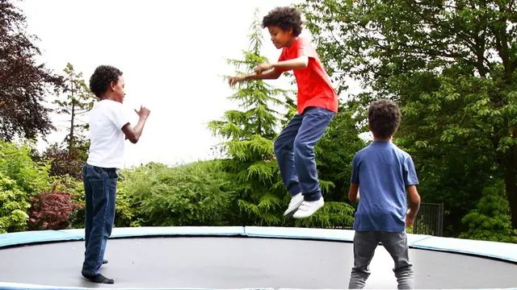
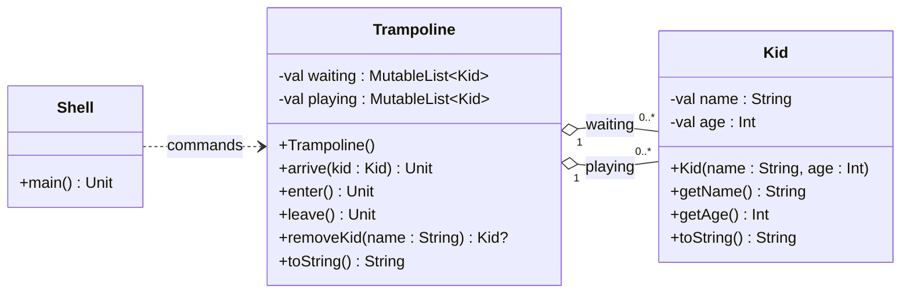

# [TRAIN] Pula-pula com crianças

<!-- toc-table -->
[Intro](#intro) | [Diagrama](#diagrama) | [Guide](#guide) | [Shell](#shell)
-- | -- | -- | --
<!-- end -->



Nosso objetivo no trabalho é modelar um gestor de pula pulas em um parquinho, controlando as pessoas que entram e saem do pula pula, além de coordenar as pessoas que estão na fila de espera.

## Intro

Esta atividade trabalha coleções lineares de objetos. O pula pula possui duas listas: uma fila de espera e uma lista de crianças brincando. As operações movem crianças entre essas listas sem criar uma posição fixa para cada criança.

- Inserir crianças na fila de espera do pula pula.
- Mover a primeira criança da fila de espera para dentro do pula pula.
- Mover a primeira criança que entrou no pula pula para o final da fila de espera.
- Buscar uma criança pelo nome para removê-la, esteja ela esperando ou brincando.

O foco é perceber que a posição na lista muda conforme as operações acontecem. Aqui a posição indica ordem de chegada ou de saída, não uma cadeira, caixa ou slot permanente.

***

## Diagrama

`Trampoline` mantém duas ordens variáveis de crianças: a fila `waiting` e a lista `playing`. As crianças são criadas pelo `Shell` e apenas referenciadas pelo pula-pula, por isso a relação é uma agregação.



***

## Guide


`Kid` guarda nome e idade. `Trampoline` coordena duas `MutableList<Kid>`: `waiting` e `playing`. As listas ficam privadas, e as operações do pula-pula definem como as crianças mudam entre elas.

- `arrive(kid)` insere a criança no início de `waiting`.
- `enter()` remove a última criança de `waiting` e a insere no início de `playing`, mantendo a ordem de chegada.
- `leave()` remove a última criança de `playing` e a coloca no início de `waiting`.
- `removeKid(name)` procura primeiro em `waiting`, depois em `playing`, e devolve a criança removida ou `null`.
- `toString()` deve mostrar as duas listas como `[waiting] => [playing]`.

Os comandos do Shell (`arrive`, `enter`, `leave` e `remove`) permanecem iguais por serem parte do contrato externo.
O `Shell` separa cada linha com `split(" ")` e acessa os argumentos necessários ao comando. Em `main()`, captura `NumberFormatException` para mostrar `fail: conversao invalida` e `IndexOutOfBoundsException` para mostrar `fail: parametros insuficientes`. Em ambos os casos, continua recebendo comandos sem alterar o pula-pula.

## Shell

```bash
#TEST_CASE unico
# $chegou _nome _idade
# insere uma criança na fila de entrada do brinquedo
$arrive mario 5
$arrive livia 4
$arrive luana 3

# show
# mostra a fila de entrada e o pula pula
$show
[luana:3, livia:4, mario:5] => []

#TEST_CASE entrando
# entrar
# tira a primeira criança da fila de entrada e insere no pula pula

$enter
$show
[luana:3, livia:4] => [mario:5]

#TEST_CASE segunda pessoa
$enter
$show
[luana:3] => [livia:4, mario:5]

#TEST_CASE saindo
$leave
$show
[mario:5, luana:3] => [livia:4]

#TEST_CASE remove
$remove luana

$show
[mario:5] => [livia:4]
$remove livia
$show
[mario:5] => []
$end
```

```bash
#TEST_CASE invalid age keeps state and shell running
$arrive ana 5
$arrive bia idade
fail: conversao invalida
$arrive bia
fail: parametros insuficientes
$remove
fail: parametros insuficientes
$show
[ana:5] => []
$arrive bia 4
$show
[bia:4, ana:5] => []
$end
```

***

```bash
#TEST_CASE 2
$show
[] => []
$arrive mario 5
$show
[mario:5] => []

#TEST_CASE empty enter
$enter
$show
[] => [mario:5]

#TEST_CASE empty leave
$leave
$show
[mario:5] => []
$leave
$show
[mario:5] => []

#TEST_CASE remove from waiting
$remove mario
$show
[] => []

#TEST_CASE remove empty
$remove rebeca
fail: rebeca nao esta no pula-pula

$show
[] => []
$end
```
