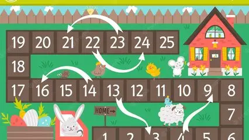
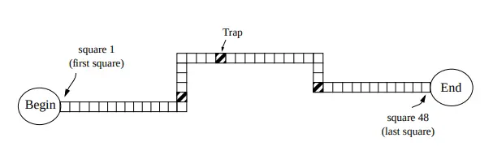
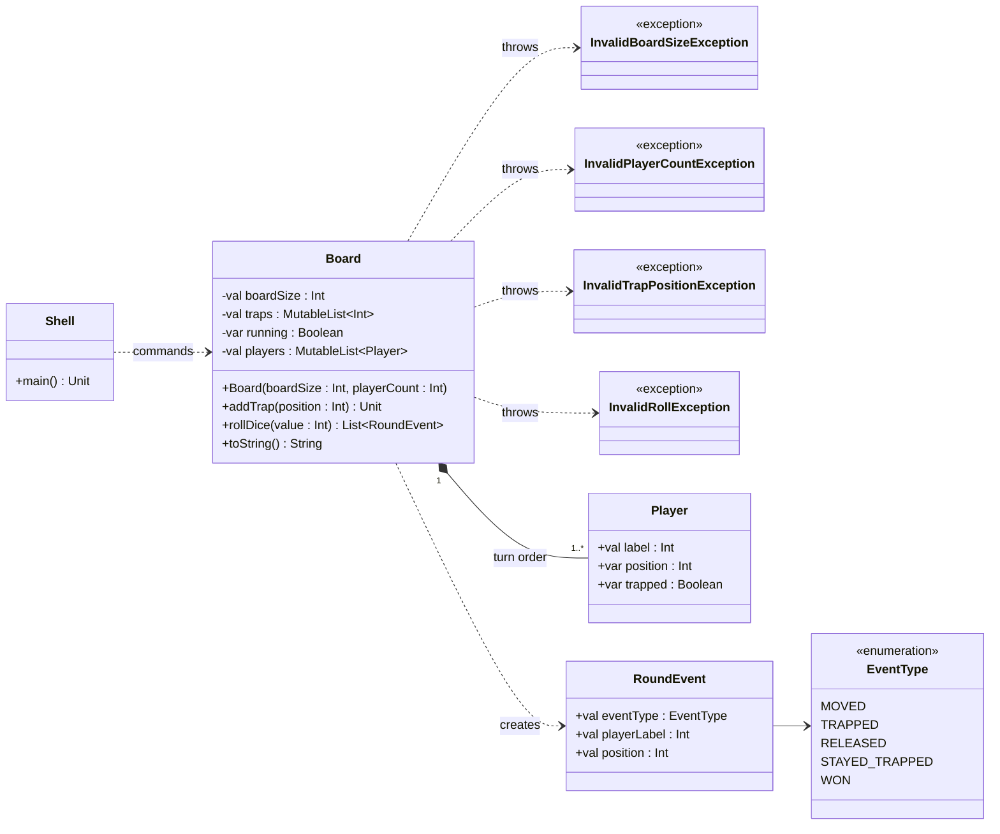

# [CHECK] Tabuleiro: coleções na simulação de turnos

<!-- toc-table -->
[Intro](#intro) | [Regras](#regras) | [Objetivos pedagógicos](#objetivos-pedagógicos) | [Diagrama](#diagrama) | [Guide](#guide) | [Shell](#shell) | [Drafts](#drafts)
-- | -- | -- | -- | -- | -- | --
<!-- end -->



## Intro

Nosso jogo consiste em um tabuleiro contendo uma trilha de quadrados e um conjunto de peças coloridas. No início do jogo, cada jogador recebe uma peça; todas as peças são inicialmente posicionadas na posição 0 da trilha.

O jogo prossegue em rodadas. Em cada rodada, os jogadores rolam um D20 (dado de 20 faces) e movem suas peças para frente um número de quadrados igual ao resultado obtido pelos dados. Os jogadores rolam os dados sempre na mesma ordem (jogador A, depois jogador B, etc.) nas rodadas.

A maioria dos quadrados no tabuleiro são quadrados simples, mas alguns são “armadilhas”. Se a peça de um jogador cair em um quadrado da armadilha no final do movimento do jogador. O jogador ficará preso na armadilha até que na sua rodada jogue um número par se libertando da armadilha. Ao rolar um número par e se libertar da armadilha, sua peça não se move nessa rodada, mas na próxima poderá se mover normalmente.



As armadilhas são adicionadas pelo comando `addTrap`; não há limite para a quantidade delas.

O vencedor do jogo é o jogador cuja peça chega primeiro ao final da trilha. O fim da trilha é depois da última casa do tabuleiro. Considere, por exemplo, a placa da figura acima, que tem quadrados numerados de 1 a 48. No início, as peças são posicionadas no local marcado como 'Início', ou seja, antes do quadrado número 1. Portanto, se um jogador rolar um 7, sua peça é posicionada na casa número 7 no final da primeira rodada do jogo.
Além disso, se a peça de um jogador estiver posicionada na casa 41, o jogador precisa de um resultado de rolagem de pelo menos 8 para chegar ao final da trilha e ganhar o jogo. Observe também que não haverá empate no jogo.

___

Questão adaptada da maratona ACM 2003 por @WladimirTavares

## Regras

- `Board(boardSize: Int, playerCount: Int)` exige ambos positivos e lança `InvalidBoardSizeException` ou `InvalidPlayerCountException` quando a construção é inválida. Todos começam na posição `0`.
- Há um tabuleiro com `boardSize` casas numeradas de `1` até `boardSize`; a última posição encerra a partida.
- Os jogadores jogam na ordem da lista. A cada rodada, o primeiro jogador rola e vai para o fim da ordem.
- Se o jogador não estiver preso, avança o valor rolado. Chegar ou passar de `boardSize` encerra a partida e dá a vitória; compare a rolagem com a distância restante para evitar overflow na soma de inteiros.
- `addTrap(position: Int): Unit` aceita posições de `1` até `boardSize - 1`, sem limite de quantidade. Posição fora dessa faixa lança `InvalidTrapPositionException` sem alterar as armadilhas. Posições repetidas são aceitas.
- Cair em uma armadilha prende o jogador; em rodadas seguintes, resultado ímpar o mantém preso e resultado par o liberta sem mover.
- `rollDice(value: Int): List<RoundEvent>` lança `InvalidRollException` para valores não positivos antes de mudar a ordem ou posição dos jogadores. Valores acima de 20 continuam aceitos nesta atividade.
- Uma partida encerrada não aceita novas jogadas: `rollDice` retorna uma lista vazia e preserva o estado, inclusive se o valor recebido não for positivo.

## Objetivos pedagógicos

O objetivo principal é consolidar o uso de coleções para coordenar uma simulação de turnos. Como objetivos secundários, a atividade trabalha o encapsulamento do estado de cada jogador e a transição para um estado terminal quando alguém vence.

### Conhecimentos prévios

São necessários objetos, listas, condicionais, laços, métodos, índices e valores booleanos.

### Invariantes e elementos observáveis

- os jogadores começam na posição `0` e cada um possui uma peça;
- a lista de jogadores representa a ordem dos turnos e gira após cada jogada;
- uma armadilha é verificada somente depois do movimento;
- jogador preso não se move até tirar um número par;
- ao se libertar, o jogador não se move naquela rodada;
- depois da vitória, novas rolagens não alteram o estado;
- a saída de `show` permite observar posições, ordem dos turnos e armadilhas.

O contexto usa um D20, mas a atividade exige apenas rolagens positivas, sem impor o limite de 20. O Shell usa `split(" ")`, acessa os argumentos diretamente e captura em `main()` as exceções do domínio, conversão inválida (`fail: invalid conversion`) e argumento ausente (`fail: insufficient parameters`).

## Diagrama

`Board` cria e ordena os jogadores, registra as armadilhas e encerra a partida quando alguém vence. Cada `rollDice` retira o primeiro jogador, produz eventos e o recoloca no fim da ordem enquanto a partida estiver ativa.



O diagrama usa os tipos e as coleções de Kotlin, além de distinguir propriedades imutáveis (`val`) das mutáveis (`var`). Nomes de propriedades e funções seguem `camelCase`, assim como os comandos do Shell, que fazem parte do contrato externo.

## Guide


Comece modelando `Player` como uma classe comum, com sua posição e o estado `trapped`. Modele também `RoundEvent` como uma classe comum para registrar o resultado de cada etapa do turno. Depois modele `Board`, que possui a lista de jogadores, as posições das armadilhas e o estado de execução. Valide tamanho e quantidade de jogadores antes de criar as coleções.

Ao adicionar uma armadilha, valide sua posição, sem impor limite de quantidade. Posições repetidas não mudam a representação visual nem o efeito de cair na casa. Antes de retirar um jogador para a rodada, rejeite uma rolagem não positiva. Uma rodada válida retira o primeiro jogador da lista, aplica a regra correspondente e o coloca no final da lista. O domínio retorna eventos, como movimento, armadilha, libertação ou vitória; o `Shell` usa `when` para apresentá-los diretamente.

Ao testar, verifique tanto a mensagem produzida quanto a posição, o estado de prisão, a ordem dos turnos e o fato de que uma partida encerrada não muda mais.


___

## Shell

```s
#TEST_CASE init
$init 2 10
$show
player1: 1..........
player2: 2..........
traps__: ...........

$addTrap 2
$addTrap 4
$addTrap 8
$show
player1: 1..........
player2: 2..........
traps__: ..x.x...x..

#TEST_CASE move
$roll 1
player1 andou para 1

#TEST_CASE trap
$roll 2
player2 andou para 2
player2 caiu em uma armadilha

#TEST_CASE show
$show
player1: .1.........
player2: ..2........
traps__: ..x.x...x..

#TEST_CASE keep trapped
$roll 4
player1 andou para 5
$roll 3
player2 continua preso

$show
player1: .....1.....
player2: ..2........
traps__: ..x.x...x..

#TEST_CASE trap
$roll 3
player1 andou para 8
player1 caiu em uma armadilha

#TEST_CASE release
$roll 6
player2 se libertou

$show
player1: ........1..
player2: ..2........
traps__: ..x.x...x..

#TEST_CASE win
$roll 2
player1 se libertou
$roll 10
player2 ganhou

#TEST_CASE boundary
$show
player1: ........1..
player2: ..........2
traps__: ..x.x...x..

#TEST_CASE game over
$roll 1
game is over
$end
```

```s
#TEST_CASE vitória exata e estado terminal
$init 2 5
$roll 5
player1 ganhou
$roll 1
game is over
$show
player2: 2.....
player1: .....1
traps__: ......
$end
```

```bash
#TEST_CASE mais de três armadilhas
$init 2 6
$addTrap 1
$addTrap 2
$addTrap 3
$addTrap 4
$show
player1: 1......
player2: 2......
traps__: .xxxx..
$roll 1
player1 andou para 1
player1 caiu em uma armadilha
$end
```

```bash
#TEST_CASE configuracao invalida preserva o tabuleiro
$init 2 5
$addTrap 2
$init 0 5
fail: invalid player count
$init 2 0
fail: invalid board size
$show
player1: 1.....
player2: 2.....
traps__: ..x...
$end
```

```bash
#TEST_CASE armadilhas fora da trilha e repetidas
$init 2 5
$addTrap 0
fail: invalid trap position
$addTrap 5
fail: invalid trap position
$addTrap -1
fail: invalid trap position
$addTrap 2
$addTrap 2
$show
player1: 1.....
player2: 2.....
traps__: ..x...
$end
```

```bash
#TEST_CASE rolagem invalida preserva a ordem
$init 2 5
$roll 0
fail: invalid roll
$roll -1
fail: invalid roll
$show
player1: 1.....
player2: 2.....
traps__: ......
$roll 21
player1 ganhou
$roll 0
game is over
$end
```

```bash
#TEST_CASE rolagem grande chega ao fim
$init 2 5
$roll 2147483647
player1 ganhou
$show
player2: 2.....
player1: .....1
traps__: ......
$end
```

```bash
#TEST_CASE argumentos invalidos nao interrompem o shell
$init 2 5
$init 2
fail: insufficient parameters
$addTrap texto
fail: invalid conversion
$roll
fail: insufficient parameters
$show
player1: 1.....
player2: 2.....
traps__: ......
$end
```

## Drafts

<!-- links .cache/starter -->
<!-- end -->
